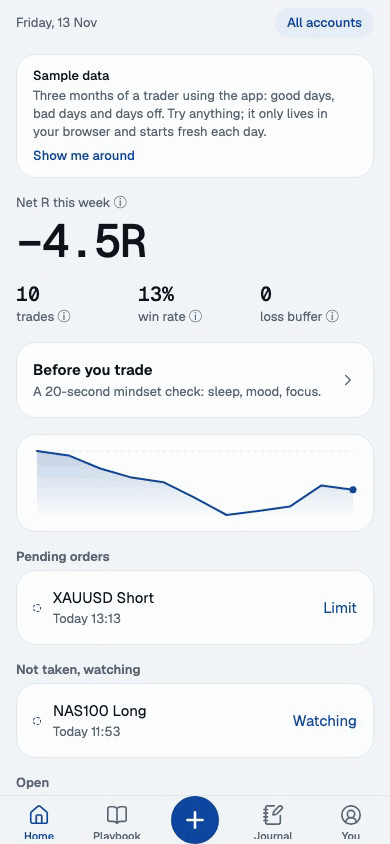
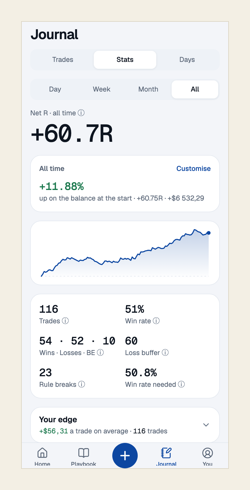

# Next Entry

**The trading journal that steps in before the next bad trade.** A checklist and a short check-in before you enter,
quick logging, then guardrails and an honest read of your results.

**Live:** [nextentry.app](https://nextentry.app) · free during the beta on iPhone (TestFlight) and Android (Google
Play testing), with a browser demo on sample data.

> This repository holds no code; the app's source is private. This page shows what the app does and how it is built.

## Who it is for

Traders who know their plan but struggle to stick to it, first for the P3xA price-action community. Next Entry is
not a journal first: it is there at the moment you are about to enter.

## What it does

**Before the trade**
- Confluence checklists with must-haves for each setup.
- A 20-second check-in: sleep, mood, focus, and whether you're chasing a loss.
- A playbook of your setups and rules.

**The trade**
- Quick logging, with risk in R or in cash.
- Limit and stop orders, partials and breakeven, commission per lot.
- One entry across several accounts.

**After the trade**
- A loss buffer and guardrails: a pause after a loss and a daily stop.
- Stats: edge, drawdown, streaks, calendars and results by session.
- A private journal.

## How it's built

| | |
| --- | --- |
| **Built by** | Theuns Pienaar, from scratch, since October 2026 |
| **Platforms** | iPhone, Android and the web from one codebase |
| **Stack** | Expo and React Native, Expo Router, TypeScript, SQLite on the phone |
| **Data** | No account and no sign-in. Everything stays on the phone, with backup and restore to a file, including to a new phone. No broker connection: you log trades yourself and the app never places one. |

## What made it hard

- **Offline and private by design.** With no server and no account, backups, restores and moving to a new phone all
  have to work from a single file.
- **Trading maths that has to be right.** R and cash risk, partial closes, breakeven and commission all feed the stats,
  and the maths is covered by unit tests.
- **One codebase, three places.** The same app ships to iPhone, Android and a web demo that keeps its sample data in
  the browser.

## Want to see it?

Try the [web demo](https://nextentry.app/demo) or find me at [freerein.dev](https://freerein.dev).

---

Made by P3xA. Next Entry is a journal, not financial advice.
